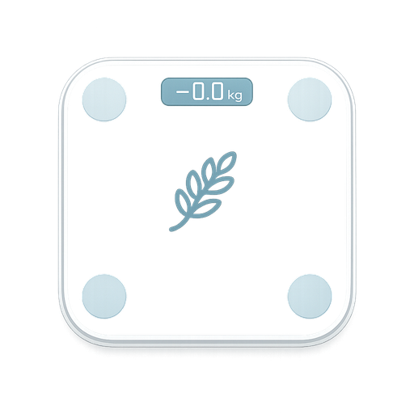

<p align="center">
  
</p>

# Yunmai Scale for Home Assistant

A local Home Assistant custom integration for compatible Yunmai Bluetooth body scales. It maintains a persistent BLE connection, recognizes configured users from live weight, sends the selected profile to the scale, and publishes the final measurement without using the Yunmai cloud.

> **Current status:** pre-release testing (`0.3.11-test`). The protocol and reconnect behavior have been validated on a `YUNMAI-SIGNAL-CW`. Other discovered model names are not yet confirmed with real hardware.

## Features

- Local BLE operation; no Yunmai account or cloud connection.
- Persistent connection with automatic reconnect after a real BLE disconnect.
- Multiple user profiles with live-weight recognition.
- Weight, body-fat value returned by the scale, last measurement time, and optional raw impedance.
- Protection against repeated final packets and measurements that begin during reconnect/bootstrap.
- Optional per-device BlueZ connection-parameter optimization for lower idle battery use.
- English and Russian interface translations.

## Confirmed hardware

- `YUNMAI-SIGNAL-CW`

The integration also advertises discovery matchers for several other Yunmai names, but compatibility is not guaranteed until their GATT protocol and packets are verified.

## Requirements and limitations

- Home Assistant with a Bluetooth adapter or compatible active Bluetooth proxy.
- The tested and fully supported arrangement is a **local BlueZ adapter** on Home Assistant OS.
- Low-level BLE power optimization is available only for a local BlueZ adapter. It is skipped for proxies or when the required management access is unavailable.
- A scale normally accepts only one BLE client. Disable openScale, the Yunmai app, and other Home Assistant instances while this integration is active.
- The body-fat value is calculated by the scale firmware and is not presented as medically accurate.
- No battery level is exposed: this model has no standard BLE Battery Service and no verified battery field in the observed protocol.

## Installation with HACS

Until the repository is included in HACS defaults:

1. Open **HACS → Integrations**.
2. Open the menu and choose **Custom repositories**.
3. Add:

   ```text
   https://github.com/Taxom/home-assistant-yunmai-scale
   ```

4. Select category **Integration**.
5. Install **Yunmai Scale** and restart Home Assistant.

## Manual installation

Copy:

```text
custom_components/yunmai_scale
```

to:

```text
/config/custom_components/yunmai_scale
```

Restart Home Assistant.

## Configuration

1. Wake the scale.
2. Open **Settings → Devices & services → Add integration**.
3. Search for **Yunmai Scale**.
4. Select the discovered device, or enter its stable Bluetooth MAC address.
5. Add at least one user profile with a realistic reference weight.

The profile reference weight is updated after a successful measurement and is used for the next recognition cycle.

## Entities

For each profile:

- Weight
- Body fat
- Last measurement
- Raw impedance, disabled by default

For the scale:

- Last recognized user
- Session status with diagnostic attributes

## Options

### User profiles

Profiles can be added, edited, or deleted independently. Editing preserves the profile UID so existing entity registry entries and stored measurements remain associated with that person.

### Recognition thresholds

The defaults are intentionally conservative:

- nearest profile within ±10%;
- at least 2 kg closer than the second profile;
- 3 consecutive matching frames;
- no more than 0.8 kg spread across the stable window.

Profiles with similar weights may require careful tuning and can still be ambiguous.

### Bluetooth power optimization

Available modes:

- Disabled
- Moderate
- Maximum tested
- Custom

The setting is scoped to the configured scale address and is applied again after every local reconnect. Invalid custom combinations are rejected before saving.

## Debug logging

Add temporarily to `configuration.yaml`:

```yaml
logger:
  logs:
    custom_components.yunmai_scale: debug
    bleak_retry_connector: debug
```

Restart Home Assistant and reproduce the issue. Remove verbose logging afterward.

## Reporting a problem

Open an issue and include:

- Home Assistant version and installation type;
- integration version;
- scale model and advertised Bluetooth name;
- whether the adapter is local or a Bluetooth proxy;
- relevant debug log excerpt with personal profile information removed.

Do not publish full Home Assistant diagnostics or logs without reviewing them for private information.

## Disclaimer

This is an independent community project and is not affiliated with or endorsed by Yunmai. Product and company names are used only to describe compatibility.

## License

MIT
